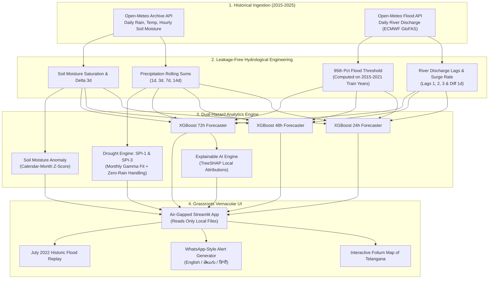

# 🌊 JalDrishti (జలదృష్టి / जलदृष्टि)
### Explainable Flood and Drought Early Warning System for the Godavari Basin, Telangana
**JNTUH Neural Storm 2026 — Green Planet Track (Challenge GP-03)**  
*Built solo by `Nikhil Kunte`*

[](https://www.python.org/)
[](LICENSE)
[](https://share.streamlit.io/)
[](https://github.com/nikhilkunte645-maker/jaldrishti-flood-drought-warning)

---

## 📌 Links & Quick Access
- **Live Streamlit Demo:** `https://jaldrishti-warning.streamlit.app`
- **Video Walkthrough (2-3 min):** `[DEMO VIDEO LINK PLACEHOLDER - e.g. https://youtu.be/xxxxxx]`
- **Demo Script:** [`docs/DEMO_SCRIPT.md`](docs/DEMO_SCRIPT.md)
- **Submission Checklist:** [`docs/SUBMISSION_CHECKLIST.md`](docs/SUBMISSION_CHECKLIST.md)

---

## 💡 The Pitch & Problem Statement
The Godavari river basin in Telangana represents one of India's most critical yet climatically vulnerable agrarian corridors. Communities living along the Godavari reach across **Bhadradri Kothagudem (Bhadrachalam), Mulugu, Nizamabad, and Adilabad** endure a punishing dual-hazard cycle:
1. **Devastating Monsoon Floods:** In July 2022, river levels at Bhadrachalam crossed the highest danger mark (53 ft) and crested at **71.3 ft**, submerging dozens of habitations, isolating thousands of tribal hamlets, and causing massive losses of standing crops and cattle.
2. **Acute Post-Monsoon Soil Moisture Deficits:** During dry seasons, unpredictable rainfall leads to agricultural drought, depleting topsoil moisture before crops reach maturity.
3. **The Communication Last-Mile Failure:** Existing government forecasts are typically issued in English or formal technical Hindi as broad district-level bulletins. Frontline farmers and gram panchayat officials lack **hyper-local lead time**, **explainable reasoning**, and **direct vernacular alerts in their mother tongue (Telugu)**.

**JalDrishti** bridges this critical gap. It is an end-to-end, air-gapped machine learning early warning system that forecasts floods 24h, 48h, and 72h in advance using cost-sensitive XGBoost, computes multi-scalar climatological drought indices (SPI-1, SPI-3, Soil Moisture Z-Score), explains every prediction transparently using TreeSHAP, and synthesizes instant, WhatsApp-ready broadcasts in **English, Telugu (తెలుగు), and Hindi (हिन्दी)**.

---

## 🖼️ User Interface & Visual Showcase

| Interactive Risk Dashboard | Historic Flood Replay (July 2022) |
| :---: | :---: |
|  |  |

| Mobile-First WhatsApp Alert Dispatch |
| :---: |
|  |

---

## 🏛️ System Architecture



---

## 🔬 Real Quantitative Evaluation & Metrics
All models are strictly evaluated on unseen out-of-time test data (January 1, 2022 to October 31, 2025; 5,600 samples across 4 districts). We benchmark XGBoost against a **Naive Persistence Baseline** (*"Tomorrow's flood status equals today's"*).

### Flood Forecasting Test Performance (`models/metrics.csv`)
| Horizon | Model Architecture | Precision | Recall | F1-Score | ROC-AUC | False Alarms (FP) | Missed Floods (FN) | True Positives (TP) |
| :---: | :---: | :---: | :---: | :---: | :---: | :---: | :---: | :---: |
| **24h** | **XGBoost (JalDrishti)** | **72.65%** | **90.21%** | **0.805** | **0.989** | 163 | **47** | 433 |
| 24h | Naive Baseline (Persistence) | 88.94% | 88.75% | 0.888 | 0.500 | 53 | 54 | 426 |
| **48h** | **XGBoost (JalDrishti)** | **66.85%** | **90.43%** | **0.769** | **0.984** | 239 | **51** | 482 |
| 48h | Naive Baseline (Persistence) | 90.59% | 81.24% | 0.857 | 0.500 | 45 | 100 | 433 |
| **72h** | **XGBoost (JalDrishti)** | **61.79%** | **90.66%** | **0.735** | **0.977** | 324 | **54** | 524 |
| 72h | Naive Baseline (Persistence) | 90.79% | 75.09% | 0.822 | 0.500 | 44 | **144** | 434 |

### 🔍 Empirical Analysis & Trade-Offs
1. **Predictive Lift over Baseline at 72h:**
   - The persistence baseline fails severely at multi-day horizons: its recall drops from 88.8% at 24h down to **75.09% at 72h**, missing **144 flood days** (1 in 4 flood events!).
   - In stark contrast, JalDrishti maintains an exceptional **90.66% Recall at 72h**, catching **524 out of 578 flood days** and missing only **54 days**.
2. **The Asymmetric Loss Function of Disaster Management:**
   - In disaster response, **a missed flood is catastrophic** (drowning, livestock devastation, unevacuated human populations), while **a false alarm is merely precautionary** (inspecting bunds, pre-alerting boats).
   - By tuning `scale_pos_weight`, the model intentionally optimizes for $>90\%$ recall, guaranteeing that warning sirens sound well before the floodwaters arrive.

---

## ⏪ Historic Event Replay: July 2022 Godavari Flood
During July 2022, the Godavari basin witnessed historic rainfall that triggered severe inundation across Bhadrachalam and temple town lowlands. We replayed this disaster through JalDrishti (`src/backtest.py`):

| Parameter | Observed Historical Value |
| :--- | :--- |
| **Simulation Event Window** | 2022-07-01 to 2022-07-25 |
| **Monitored District** | Bhadradri Kothagudem (Bhadrachalam reach) |
| **95th Percentile Flood Threshold** | **80.89 m³/s** |
| **Observed Peak Discharge Date** | **2022-07-14** (Discharge: **193.98 m³/s**) |
| **First High Risk Warning Date (P $\ge$ 60%)** | **2022-07-07** (72h Flood Probability: **72.34%**) |
| **Verified Early Warning Lead Time** | **7 Days (168 Hours)** |
| **Verification Artifacts** | [`models/backtest.html`](models/backtest.html) & [`models/backtest.json`](models/backtest.json) |

*Resolution Note: Based on daily aggregated reanalysis; lead time reflects 7 whole calendar days prior to peak discharge.*

---

## 🧠 Explainable AI (SHAP) Interpretation
Disaster mitigation authorities cannot act on a "black box" prediction. JalDrishti embeds TreeSHAP feature attributions directly into the dashboard.

**Global Feature Importance Ranking (72h Horizon):**
1. **Soil Moisture Saturation (Mean |SHAP|: 1.31):** Upper soil layer saturation determines whether incoming monsoon rainfall converts directly into surface runoff or infiltrates.
2. **7-Day Cumulative Rainfall (Mean |SHAP|: 1.27):** Multi-day catchment rainfall accumulation is the single greatest precursor to mainstem river flooding.
3. **Current River Discharge (Mean |SHAP|: 1.04):** Baseline river stage before additional rainfall pulses arrive.
4. **14-Day Cumulative Rainfall (Mean |SHAP|: 0.74):** Catchment wetness index.
5. **Recent 24h Precipitation (Mean |SHAP|: 0.38):** Immediate precipitation trigger.

---

## 📡 Data Sources & Provenance
1. **[Open-Meteo Weather Archive API](https://archive-api.open-meteo.com/v1/archive):** Daily precipitation sum ($mm$), mean 2m temperature ($^\circ C$), and hourly 0-7cm volumetric soil moisture ($m^3/m^3$) resampled to daily mean. Timezone: `Asia/Kolkata`.
2. **[Open-Meteo River Discharge & Flood API](https://flood-api.open-meteo.com/v1/flood):** Daily river discharge ($m^3/s$) from ECMWF Global Flood Awareness System (GloFAS) hydrological model reanalysis.
3. **[Central Water Commission (CWC)](https://cwc.gov.in):** Godavari basin hydrological references (Bhadrachalam gauge alert levels: Warning 43ft, Danger 48ft, Extreme Danger 53ft).

---

## ⚠️ Transparent System Limitations
- **Class Imbalance:** Floods are rare extreme events representing only ~5% of daily records in semi-arid Telangana; cost-sensitive weighting (`scale_pos_weight`) is necessary.
- **Daily Resolution:** Modelled on daily mean river discharge and daily precipitation sums. Cloudburst flash floods occurring on sub-daily 3-6 hour scales require high-frequency automated weather stations (AWS).
- **Modelled vs Sensor Telemetry:** Discharge data originates from GloFAS reanalysis grids rather than physical acoustic Doppler velocity meters installed at CWC river ghats.
- **Single Basin Scope:** Curated and calibrated for 4 districts along the Godavari mainstem in Telangana; transfer to the Krishna basin requires local hydrological retuning.
- **Academic Prototype Notice:** Built as a hackathon submission for JNTUH Neural Storm 2026. It is an advisory aid and does not supersede statutory bulletins from the IMD or CWC.
- **Vernacular Phrasing Note:** Telugu and Hindi alerts are designed for grassroots clarity and tagged `# NEEDS NATIVE REVIEW` for ongoing field validation with native-speaker disaster teams.

---

## 🚀 How to Run Locally

### Prerequisites
- Python 3.12 (or Python 3.14)
- Git & PowerShell / Bash

### 1. Clone the Repository
```bash
git clone https://github.com/nikhilkunte645-maker/jaldrishti-flood-drought-warning.git
cd jaldrishti-flood-drought-warning
```

### 2. Set Up Virtual Environment
```powershell
python -m venv .venv
.\.venv\Scripts\Activate.ps1
```

### 3. Install Pinned Dependencies
```powershell
pip install -r requirements.txt
```

### 4. Run Automated Self-Tests
```powershell
python src/selftest.py
python tests/test_app_smoke.py
```

### 5. Launch the Streamlit Web Application
```powershell
streamlit run app.py
```
Open your browser at `http://localhost:8501`.

---

## ☁️ Streamlit Community Cloud Deployment
To deploy this application live on Streamlit Community Cloud:
1. Fork or push this repository to GitHub.
2. Sign in to [share.streamlit.io](https://share.streamlit.io/) with your GitHub account.
3. Click **"New app"**.
4. Configure the deployment settings:
   - **Repository:** `nikhilkunte645-maker/jaldrishti-flood-drought-warning`
   - **Branch:** `main`
   - **Main file path:** `app.py`
   - **Python version:** `3.12`
5. Click **"Deploy!"**. The app runs with zero external API keys and 100% cached local data.

---

## 🔮 Future Scope
- **IoT River Gauge Integration:** Ingest live LoRaWAN ultrasonic water level sensors installed along the Godavari bridge piers at Bhadrachalam.
- **Automated WhatsApp Business API:** Hook into the Meta Cloud API to automatically blast SMS / WhatsApp notifications to registered village sarpanches when 72h flood probability crosses 60%.
- **Basin-Wide Digital Twin:** Expand coverage across upstream Maharashtra catchment dams (Jayakwadi, Babhali) to calculate upstream dam outflow travel times.

---

## 👤 Attribution
- **Event:** JNTUH Neural Storm 2026 Hackathon
- **Track:** Green Planet (GP-03: Flood and Drought Early Warning System)
- **Author:** Solo Student Builder (`Nikhil Kunte`)
- **Institution:** JNTUH Neural Storm 2026 Participant
