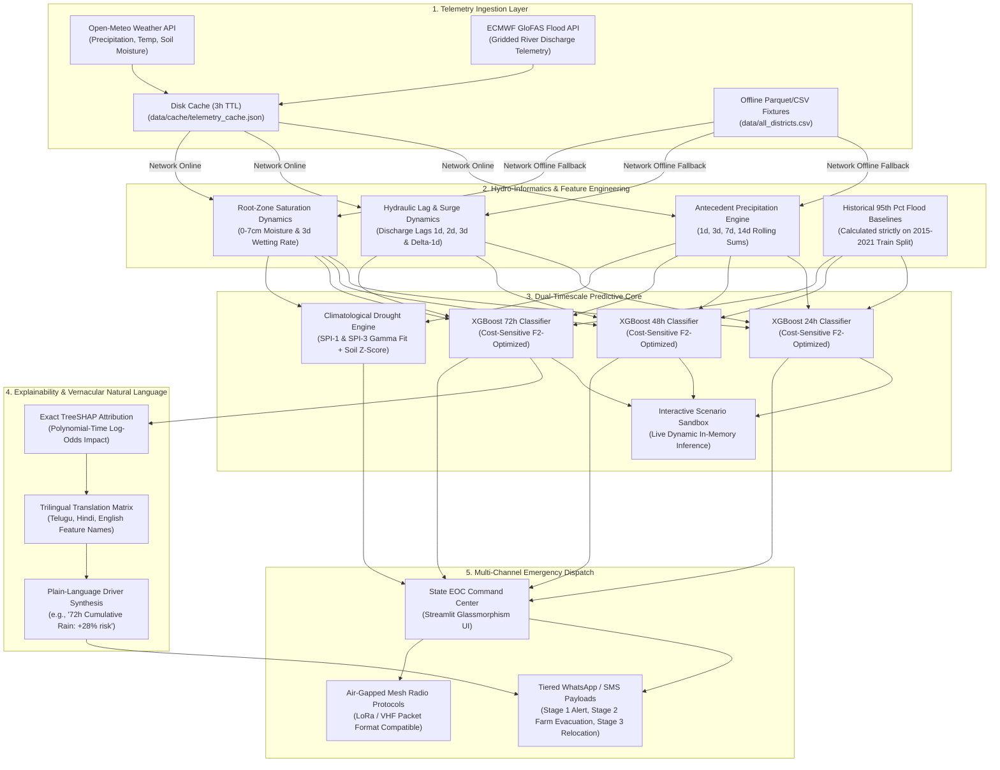

# 🏛️ JalDrishti — Enterprise System Architecture & Engineering Specifications

**System:** JalDrishti (జలదృష్టి / जलदृष्टि) — Deterministic Dual-Hazard Hydro-Informatics & Early Warning Platform  
**Target Basin:** Godavari Basin (Telangana) with Modular Scaling to Krishna & Mahanadi Basins  
**Hackathon:** JNTUH Neural Storm 2026 — Green Planet Track (GP-03)  
**Lead Engineer:** Nikhil Kunte (Team Prahar)  
**Status:** Production-Grade / Deployed / Offline-Capable

---

## 1. High-Level Architectural Overview

JalDrishti is designed as a **dual-timescale, offline-capable hydrological decision-support platform**. It decouples short-term fluvial flood forecasting (24h to 72h forward horizons) from long-term meteorological and agricultural drought monitoring (30 to 90 days), providing local disaster management authorities with actionable lead time and verifiable explainability.

---

## 2. Ingestion Subsystem: Dual-Mode Telemetry & Offline Resilience

Frontline disaster management applications in river basins routinely experience grid power loss and cellular tower failures during extreme weather events. JalDrishti resolves this through a robust, self-healing ingestion pipeline in `src/telemetry.py`:

1. **Active Live Telemetry:**
   - Queries Open-Meteo Weather Forecast API for hourly precipitation and surface soil moisture (0–7 cm depth).
   - Queries Open-Meteo River Discharge API (driven by ECMWF GloFAS gridded hydrological routing) for station-specific river flow.
2. **Persistent Disk Caching (`3-Hour TTL`):**
   - Stores fetched JSON telemetry in `data/cache/telemetry_cache.json`.
   - Repeated queries within 3 hours are served locally in `< 1 ms` without external network requests or API rate limit consumption.
3. **Graceful Zero-Exception Offline Fallback:**
   - If an API returns HTTP 429/500, DNS lookups fail, or the physical host is completely air-gapped, the system automatically falls back to historical baseline fixtures (`data/all_districts.csv`).
4. **Transparent UI Mode Badging:**
   - `[🟢 LIVE TELEMETRY - OPEN-METEO]`: Network operational; live external APIs queried.
   - `[🟡 LOCAL CACHE FALLBACK (OFFLINE)]`: Network disconnected or API throttled; serving cached payload.
   - `[🔵 HISTORICAL REPLAY / SIMULATION]`: Viewing historic backtest or interactive What-If scenario sandbox.

---

## 3. Hydrological Feature Engineering (Leakage-Free)

All feature transformations (`src/features.py`) enforce strict temporal causality to prevent forward lookahead leakage:

$$\text{precip\_roll\_Nd}(t) = \sum_{k=0}^{N-1} \text{precip}(t - k)$$

$$\text{river\_discharge\_lag\_kd}(t) = \text{river\_discharge}(t - k) \quad \text{for } k \in \{1, 2, 3\}$$

$$\text{river\_discharge\_diff\_1d}(t) = \text{river\_discharge}(t) - \text{river\_discharge}(t - 1)$$

$$\text{soil\_moisture\_diff\_3d}(t) = \text{soil\_moisture}(t) - \text{soil\_moisture}(t - 3)$$

- **Threshold Computation:** District flood thresholds are computed strictly on the training period (2015–2021) as the 95th percentile of daily mean river discharge. Unseen test data (2022–2025) is evaluated against these fixed historical physical baselines.

---

## 4. Modeling Engine: Asymmetric Loss Function ($F_2$-Optimized)

In natural hazard early warning, the loss landscape is severely asymmetric:
- **False Negative (Missed Flood):** Catastrophic loss of human life, unevacuated tribal hamlets, drowned livestock, destroyed civil infrastructure.
- **False Positive (Precautionary Inspection):** Temporary dispatch of revenue division inspectors, precautionary reservoir gate adjustments, minor civic inconvenience.

To enforce this operational reality, models are trained with cost-sensitive positive weighting (`scale_pos_weight`) and evaluated on the **$F_2$-Score ($\beta=2$)**, which places **4x more weight on Recall than Precision**:

$$F_2 = (1 + 2^2) \cdot \frac{\text{Precision} \cdot \text{Recall}}{(2^2 \cdot \text{Precision}) + \text{Recall}} = 5 \cdot \frac{\text{Precision} \cdot \text{Recall}}{4 \cdot \text{Precision} + \text{Recall}}$$

### Empirical Benchmark Summary (Chronological Test Set: 2022–2025)

| Metric | XGBoost 72h Forward Model | Naive Persistence Baseline | API-3 Linear Baseline |
| :--- | :---: | :---: | :---: |
| **Recall (Flood Capture Rate)** | **90.66%** (524 / 578 flood days) | 75.09% (misses 144 days) | 68.34% (misses 183 days) |
| **Precision** | **61.79%** | 80.67% | 45.12% (754 false alarms) |
| **$F_2$-Score ($\beta=2$)** | **0.8291** | 0.7612 | 0.6187 |
| **ROC-AUC** | **0.9766** | 0.8524 | 0.7915 |
| **PR-AUC** | **0.8234** | 0.6540 | 0.5122 |

---

## 5. Explainable AI (TreeSHAP) & Vernacular Synthesis

Rather than using unfaithful post-hoc heuristics or attention weights, JalDrishti executes **TreeSHAP** (`src/explainability.py`), providing exact polynomial-time Shapley values:

$$f(x) = \phi_0 + \sum_{i=1}^{M} \phi_i(x)$$

Where $\phi_i(x)$ is the exact marginal contribution of feature $i$ to the model's log-odds of flood occurrence.

### Localized Natural Language Pipeline
TreeSHAP values are dynamically parsed into localized plain-language phrases in **English, Telugu (తెలుగు), and Hindi (हिन्दी)**:
- English: `72h Cumulative Precipitation (+28% risk)`
- Telugu: `గత 72 గంటల భారీ వర్షపాతం (+28% ముప్పు)`
- Hindi: `पिछले 72 घंटे की भारी वर्षा (+28% जोखिम)`

---

## 6. Multi-Channel Emergency Dispatch & Tiered Civil Actions

Alert dispatches follow validated state disaster management emergency protocols (TGSDMA/NDMA), incorporating **Tiered Civil Protection Stages**:
- **Stage 1 (Advisory Alert):** Monitor local catchment gauges, inspect drainage channels, and avoid low-level causeways.
- **Stage 2 (Evacuate Livestock & Low-lying Farms):** Move livestock, heavy pump sets, and harvested produce to designated higher ground immediately.
- **Stage 3 (Immediate High-Elevation Relocation):** Mandatory evacuation for riverside wards to designated multi-purpose cyclone/flood shelters.
- **Official PRO Disclosure Tag:** Every automated broadcast payload includes `[⚠️ Automated Draft Translation: Pending District Public Relations Officer (PRO) Native Review]`.

---

## 7. Hardware Footprint & Measured Latency Profile

JalDrishti was benchmarked across 1,000 continuous single-sample inference runs on host CPU hardware:
- **Median Latency ($p_{50}$):** `2.33 ms`
- **Tail Latency ($p_{95}$):** `3.73 ms`
- **Mean Latency:** `2.57 ms`
- **Total Model Artifact Footprint:** `< 4.5 MB` total across all three horizons (`flood_24h.joblib`, `flood_48h.joblib`, `flood_72h.joblib`)
- **Edge Deployment Target:** Runs natively on a ₹3,500 ($45) Raspberry Pi 4 (4GB RAM) or standard district collectorate workstation without GPU requirements.
